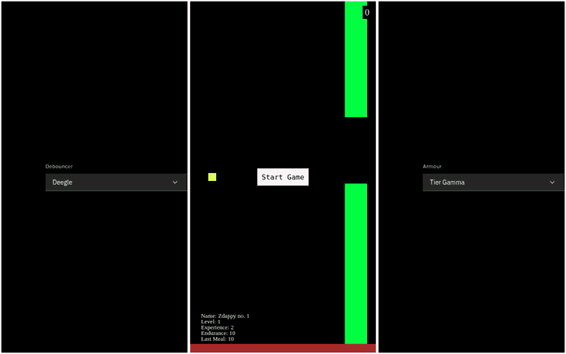

<div align="center">

# 🐤 Zdappy Bird

**A Flappy Bird–style browser game built with Svelte + TypeScript, with an ERC-721 smart contract for collectible "Zdappy" bird characters.**

[](https://cosminbmemetea.github.io/zdappy-bird/)

**▶ Live demo: https://cosminbmemetea.github.io/zdappy-bird/**

<a href="https://cosminbmemetea.github.io/zdappy-bird/"></a>

</div>

## How to play

Open the [live demo](https://cosminbmemetea.github.io/zdappy-bird/), press **Start Game**, then **click or tap anywhere** to flap. Fly through the gaps between the green pipes; each pair you pass scores a point. Hitting a pipe or the ground ends the run.

No wallet, account, or install is needed. The game runs entirely in your browser.

## Features

- Physics-driven game loop (gravity, jump velocity, collision detection) in plain TypeScript (`src/game.ts`)
- Reactive rendering with Svelte components (`Bird`, `Pipe`, `Game`)
- NFT-style character card (name, level, experience, endurance, last meal) and gear selectors built with Carbon Components
- Works on desktop and mobile (side panels hide on narrow screens)
- `contracts/Token.sol`: an ERC-721 (OpenZeppelin) contract that mints Zdappy Bird NFTs with on-chain stats (damage, magic, endurance, experience, level, last meal)

<p align="center"></p>

## Tech stack

| Layer | Tools |
| --- | --- |
| UI | [Svelte 3](https://svelte.dev), [Carbon Components Svelte](https://carbon-components-svelte.onrender.com) |
| Language | TypeScript |
| Bundler | Rollup |
| Smart contract | Solidity ^0.8, OpenZeppelin ERC-721 |
| Hosting | GitHub Pages via GitHub Actions |

## Run locally

Requires Node.js 18 or newer.

```bash
git clone https://github.com/CosminBMemetea/zdappy-bird.git
cd zdappy-bird
npm ci
npm run dev      # http://localhost:8080 with live reload
```

Production build:

```bash
npm run build    # outputs public/build/
npm start        # serves public/ at http://localhost:8080
```

### Smart contract

The contract in `contracts/Token.sol` imports OpenZeppelin directly from GitHub, so the easiest way to compile and deploy it is [Remix](https://remix.ethereum.org): paste the file, compile with Solidity 0.8.x, and deploy to a **test network** (for example Sepolia). The browser game does not connect to a wallet or a contract yet.

## Deployment

The demo is served by GitHub Pages from the `gh-pages` branch, which holds the built contents of `public/`. To update it:

```bash
npm run build
npx gh-pages -d public   # or copy public/ to the gh-pages branch by hand
```

## Privacy & security

- **No personal data is collected or stored.** There are no accounts, forms, cookies, `localStorage`, analytics, or tracking scripts. Scores live only in memory and disappear when you close the tab.
- **No wallet access.** The demo never asks for a wallet connection, signature, or transaction.
- **No backend.** It is a static site; nothing you do is sent to a server.
- The only third-party request is the IBM Plex font, loaded from IBM's CDN by the Carbon stylesheet.
- Secrets are never committed (`.env*` is git-ignored). See [SECURITY.md](SECURITY.md) to report a vulnerability.

## Roadmap

- Connect a wallet (read-only) to show the player's own Zdappy NFT stats
- Persist high scores on-chain on a testnet
- Pixel-art sprites for the bird and pipes
