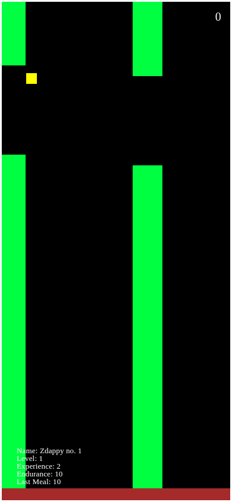

<div align="center">

# 🐤 Zdappy Bird

**A Flappy Bird–style browser game built with Svelte + TypeScript, with an ERC-721 smart contract for collectible "Zdappy" bird characters.**

[](https://cosminbmemetea.github.io/zdappy-bird/)

**▶ Live demo: https://cosminbmemetea.github.io/zdappy-bird/**

<a href="https://cosminbmemetea.github.io/zdappy-bird/"></a>

</div>

## How to play

Open the [live demo](https://cosminbmemetea.github.io/zdappy-bird/), press **Start game**, then **click, tap, or press Space / ↑** to flap. Fly through the gaps between the green pipes; each pair you pass scores a point. Hitting a pipe or the ground ends the run.

No wallet, account, or install is needed. The game runs entirely in your browser. Connecting a wallet is optional (see [Optional web3](#optional-web3-sepolia-testnet)).

## Features

- Physics-driven game loop (gravity, jump velocity, collision detection) in plain TypeScript (`src/game.ts`)
- Reactive rendering with Svelte components (`Bird`, `Pipe`, `Game`) and a fixed-timestep `requestAnimationFrame` loop
- Neon look: glowing pipes, an animated bird that tilts and flaps, scrolling ground, start and game-over screens with a best-score badge
- NFT-style character card (level, experience, endurance, last meal) and a loadout panel
- Responsive: the board sizes itself to the visible screen and refits after rotation; panels stack under it on phones. Keyboard, mouse, and touch controls; respects `prefers-reduced-motion`
- Stable mobile play: taps on the board never zoom, scroll, select text, or open a long-press menu (see [Mobile play](#mobile-play))
- Optional wallet panel: connect an injected wallet and sign your best score on the Sepolia testnet, verified in the browser
- Small footprint: about 78 KB of JS (28 KB gzipped, mostly the signature-check crypto) and 15 KB of CSS, system fonts, no UI framework
- `contracts/Token.sol`: an ERC-721 (OpenZeppelin) contract that mints Zdappy Bird NFTs with on-chain stats (damage, magic, endurance, experience, level, last meal)

<p align="center"></p>

## Tech stack

| Layer | Tools |
| --- | --- |
| UI | [Svelte 3](https://svelte.dev), hand-written CSS |
| Language | TypeScript |
| Bundler | Rollup |
| Web3 (optional) | Raw EIP-1193 + EIP-6963, [@noble/curves](https://github.com/paulmillr/noble-curves) and [@noble/hashes](https://github.com/paulmillr/noble-hashes) for local signature checks |
| Smart contract | Solidity ^0.8, OpenZeppelin ERC-721 (not deployed) |
| Tests | Vitest, Playwright (headless Chrome, desktop and Pixel 7 emulation), gitleaks |
| Hosting | GitHub Pages (`gh-pages` branch) |

## Run locally

Requires Node.js 18 or newer.

```bash
git clone https://github.com/CosminBMemetea/zdappy-bird.git
cd zdappy-bird
npm ci
npm run dev      # rebuilds on change at http://localhost:8080 (refresh the page by hand;
                 # live reload is off because the page's CSP blocks its injected script)
```

Production build:

```bash
npm run build    # outputs public/build/
npm start        # serves public/ at http://localhost:8080
```

## Optional web3 (Sepolia testnet)

The game never needs a wallet. Under the Loadout panel there's a **Wallet** card, marked *Optional · Sepolia testnet*. Nothing happens until you press **Connect wallet**.

What it does:

1. **Connect:** looks for browser wallets with [EIP-6963](https://eips.ethereum.org/EIPS/eip-6963) (falls back to `window.ethereum`). If you have several, you pick one. It then asks for an account with `eth_requestAccounts`.
2. **Show:** the short address (`0x1234…abcd`), the network, the wallet name, and a **Disconnect** button. Disconnect forgets the account and asks the wallet to revoke this site's permission if it supports `wallet_revokePermissions`.
3. **Wrong-network guard:** on any chain other than Sepolia (chain id 11155111), signing is hidden and a **Switch to Sepolia** button calls `wallet_switchEthereumChain` (or `wallet_addEthereumChain` if the wallet doesn't know Sepolia).
4. **Sign your score:** after you score at least one point, **Review message** shows the exact text, then **Sign in wallet** asks for an [EIP-191](https://eips.ethereum.org/EIPS/eip-191) `personal_sign`:

   ```text
   Zdappy Bird score

   Score: 12
   Player: 0xYourChecksummedAddress
   Network: Sepolia (11155111)
   Issued: 2026-11-15T18:00:00.000Z

   Signing proves this wallet claimed this score in your browser.
   It is free, sends no transaction, and is not uploaded anywhere.
   ```

   The page recovers the signer from the signature locally and shows **✓ Signature verified** or **✗ Signature does not match**. You can copy the signature if you want to share it.

What it does **not** do: no transactions, no gas, no token approvals, no contract calls, no WalletConnect, no RPC keys, no backend. Rejections and closed pop-ups show a short message, and the game keeps working.

Privacy: the address, network, and signature live in memory only and are gone when you close the tab. Nothing is written to cookies, `localStorage`, `sessionStorage`, or IndexedDB, and the page makes no network requests of its own (the CSP sets `connect-src 'self'`). Your wallet talks to its own RPC; the page only passes Sepolia's public RPC URL to the wallet if it has to add the network.

On a phone without a wallet extension, the card tells you to open the page in your wallet app's built-in browser.

### Smart contract (not deployed)

`contracts/Token.sol` is an ERC-721 for collectible birds with on-chain stats (damage, magic, endurance, experience, level, last meal). The owner can `mint`, and anyone can read a token's stats or list a user's tokens.

It is **not deployed**, so the web app doesn't call it. The address is a config constant:

```ts
// src/web3/config.ts
export const ZDAPPY_CONTRACT_ADDRESS: `0x${string}` | null = null;
```

> [!WARNING]
> The contract is unaudited and has known issues: `Feed`, `LevelUp`, `DamangeUp`, `MagicUp`, and `EnduranceUp` have no access control (anyone can change any token's stats), and `LevelUp` adds `new_exp % 10` to experience instead of setting it. Fix these before deploying anywhere, and only deploy to a testnet.

To try it on Sepolia:

1. Open [Remix](https://remix.ethereum.org), paste `contracts/Token.sol` (it imports OpenZeppelin from GitHub), and compile with Solidity 0.8.x.
2. In **Deploy**, choose *Injected Provider*, switch your wallet to **Sepolia**, and deploy with test ETH from a Sepolia faucet. Never use a wallet that holds real funds.
3. Verify the contract on [sepolia.etherscan.io](https://sepolia.etherscan.io), then set `ZDAPPY_CONTRACT_ADDRESS` to its address and rebuild. The wallet card then shows the contract address. Contract calls would go through the user's wallet; still no keys in the app.

## Mobile play

On phones the board owns every touch, so play doesn't wobble:

- `touch-action: none` on the board: no double-tap zoom, pinch zoom, or scrolling from the board. Touches there are handled as pointer events and become flaps.
- Non-passive `touchstart`/`touchmove` listeners on the board only (taps on the Start/Play again buttons pass through), plus `contextmenu` and iOS `gesturestart` handlers: no long-press menu, no text-selection loupe.
- `user-select: none`, `-webkit-touch-callout: none`, and a transparent tap highlight on the board.
- `overscroll-behavior: none` on the page: no pull-to-refresh or rubber-band bounce.
- During a run, the page itself stops scrolling, so a swipe beside the board can't drag it away. Scrolling comes back at game over.
- The board fits the visible viewport (`visualViewport`, `100dvh`), respects notches and home indicators (`viewport-fit=cover` + `env(safe-area-inset-*)`), and refits after rotation. If you rotate mid-run, it refits when the run ends so the physics don't jump.

Accessibility tradeoff: the viewport meta tag does **not** set `user-scalable=no` or `maximum-scale`. You can still pinch-zoom the rest of the page whenever a run isn't live. Only the board itself, and the whole page during a live run, ignore zoom and scroll gestures.

## Tests

```bash
npm run test:unit       # Vitest: message format, EIP-191 hashing, signature recovery, wallet helpers
npm run test:e2e        # Playwright: headless Chrome, desktop + Pixel 7 emulation, mocked wallets
npm run test:security   # build + all of the above + secret scan + production dependency audit
```

`test:security` covers:

- The game plays with no wallet and never contacts an installed wallet until **Connect** is clicked.
- Connect/disconnect, the EIP-6963 picker, user rejection (code 4001), and the wrong-network guard and switch, all with a mocked EIP-1193 provider.
- The wallet receives exactly the text shown on screen (byte for byte, with no extra parameters), and the signature verifies. A signature from another key is flagged.
- Nothing is written to cookies, `localStorage`, `sessionStorage`, IndexedDB, or Cache Storage, and every request goes to the page's own origin.
- The CSP meta tag is present and enforced: inline scripts, outside `fetch`es, and outside images are blocked.
- Mobile: taps flap; double-tap, pinch, and swipes on the board don't zoom or scroll; page scroll stays at 0 during a run; no long-press callout or selection; the board refits on rotation.
- `npm run scan:secrets`: gitleaks over the git history, `src/`, and the built bundle, plus checks for 64-hex keys, seed phrases, and RPC/API keys.
- `npm run audit:prod`: `npm audit --omit=dev --audit-level=high`.

Playwright uses `/usr/bin/google-chrome` or `$CHROME_PATH` if present, or its own Chromium (`npx playwright install chromium`). The secret scan needs [gitleaks](https://github.com/gitleaks/gitleaks) on `PATH` (or `GITLEAKS_BIN`). Test keys are generated fresh on every run; none are committed.

## Deployment

The demo is served by GitHub Pages from the `gh-pages` branch, which holds the built contents of `public/`. To update it:

```bash
npm run build
npx gh-pages -d public   # or copy public/ to the gh-pages branch by hand
```

## Privacy & security

- **No personal data is collected or stored.** There are no accounts, forms, cookies, `localStorage`, analytics, or tracking scripts. Scores live only in memory and disappear when you close the tab.
- **Wallet only if you ask.** The wallet card is opt-in and testnet-only. It never auto-prompts, never sends a transaction, and keeps your address in memory only. A signature is shown to you and never uploaded.
- **No backend.** It is a static site; nothing you do is sent to a server.
- **No third-party requests.** Fonts are system fonts; every file is served from GitHub Pages. A Content-Security-Policy (`connect-src 'self'`, no inline scripts) enforces this, and `npm run test:security` checks it.
- Secrets are never committed (`.env*` is git-ignored). See [SECURITY.md](SECURITY.md) to report a vulnerability.

## Roadmap

- Fix the contract's access control, deploy it to Sepolia, and show the player's own Zdappy NFT stats
- Optionally record a signed best score on-chain on a testnet
- Pixel-art sprites for the bird and pipes
